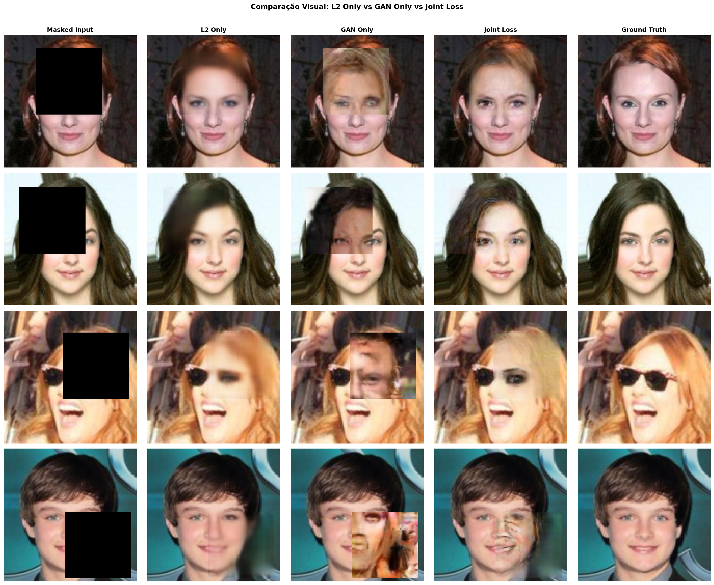
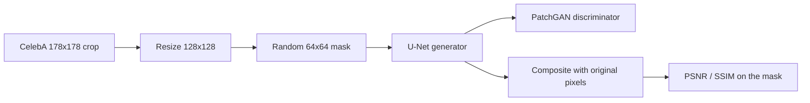
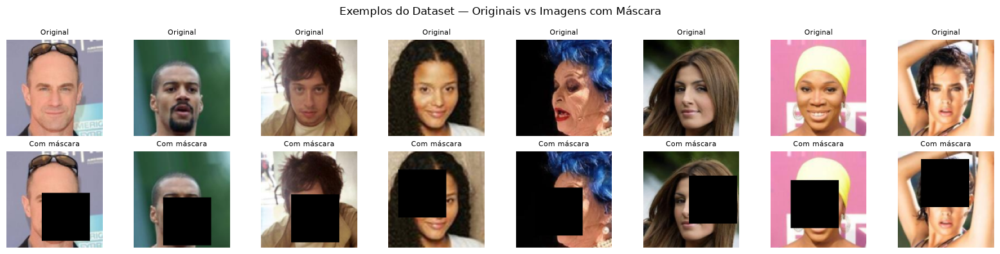
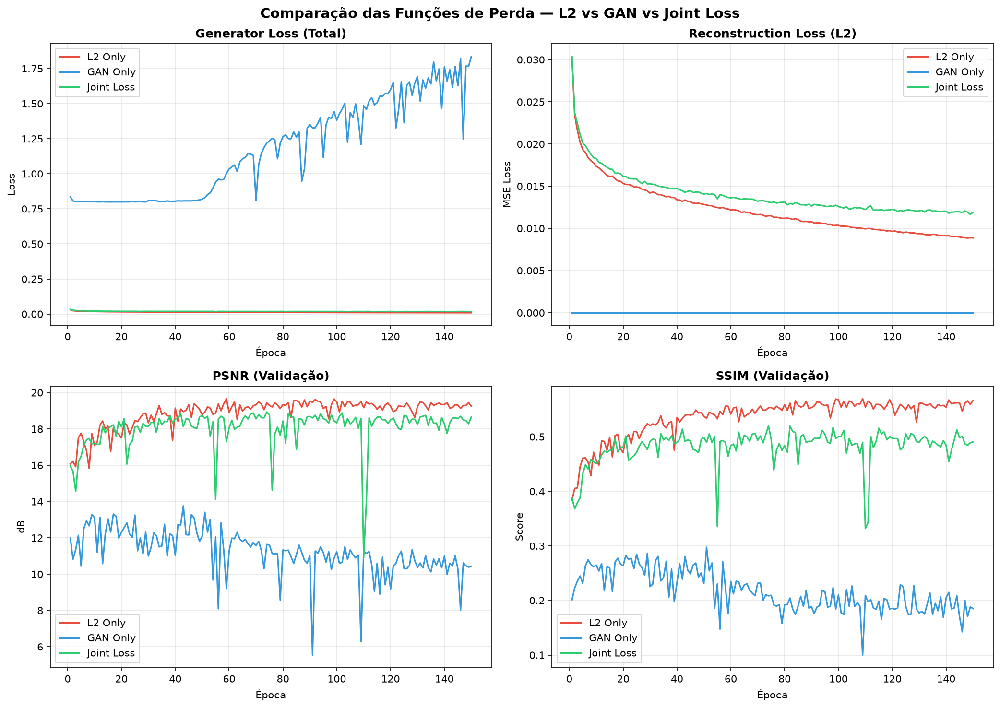
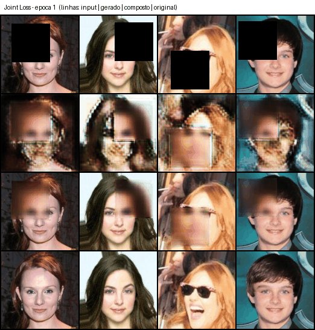

# Image Inpainting with Context Encoders


Reconstruction of erased regions of faces (CelebA) with a U-Net generator and a PatchGAN discriminator, comparing three loss functions: L2, GAN and Joint.



**[Full report (notebook, in Portuguese)](Relatório.ipynb)**

Individual academic project · Computer Vision and Image Processing · Master's in Informatics Engineering, University of Minho · 2025/2026

## Overview

Individual master's project on GANs and autoencoders, based on Pathak et al., *Context Encoders: Feature Learning by Inpainting* (CVPR 2016). A network receives an image with a square erased at a random position and has to "invent" the missing content. I trained the same model with three different losses and compared quantitative (PSNR/SSIM) and visual results.

## What I did

- Implemented a Context Encoder with a U-Net generator (30.2 M parameters) and a PatchGAN discriminator (2.8 M) in PyTorch, both adapting their depth to the image size.
- Built the CelebA data pipeline with random 64×64 masks, storing each mask's position so only the reconstructed region is evaluated.
- Trained and compared three losses (L2, GAN and Joint) for 150 epochs each, about 11 hours on an RTX 3060 Laptop.
- Tuned the adversarial weight (0.002 instead of the paper's 0.001) and replaced transposed convolutions with upsampling + convolution to avoid checkerboard artefacts.
- Evaluated with PSNR/SSIM on the masked region and documented everything in a notebook report.

## Skills demonstrated

Deep learning · generative adversarial networks · image inpainting · PyTorch · experiment design and comparison · image quality metrics (PSNR, SSIM) · GPU training

## How it works

A face image is erased in a 64×64 px square at a random position. A **generator** (U-Net) receives the image with the hole and tries to fill it. To help it produce realistic textures, a **discriminator** (PatchGAN) is trained at the same time. It looks at the image and tries to tell whether it is real or generated. This is the basic GAN idea: two competing networks, the generator trying to fool the discriminator and the discriminator trying not to be fooled.



In each training step the discriminator is updated first: it receives real images (label 0.9, via label smoothing) and generated ones (label 0). Then the generator is updated with the loss of the chosen mode. The same model is trained in three ways and compared:

- **L2 Only:** generator alone, no discriminator, minimising the pixel-wise error on the masked region. Not a GAN. Gives correct but smooth images.
- **GAN Only:** the generator only receives the discriminator's signal. With no reconstruction anchor, training is unstable and images can look convincing but be inconsistent with the context.
- **Joint Loss:** the generator receives `0.99·L2 + 0.002·GAN`. L2 keeps global coherence and the adversarial term adds local detail.

The discriminator scores the full generated image, patch by patch: it classifies each patch as real or fake, which forces the generator to get local textures right. Compositing with the original pixels outside the mask is only done to compute metrics and save samples.

### Data

CelebA (`img_align_celeba`, 202,599 images). The first 20,000 are used: 18,000 for training and 2,000 for validation. Preprocessing: `CenterCrop(178)`, `Resize(128)`, normalisation to [-1, 1]. The coordinates of each mask are stored so that only the reconstructed region is evaluated.



### Models and training

- **Generator (Context Encoder U-Net):** 30.2 M parameters. The number of blocks adapts to `IMG_SIZE`. The decoder uses `Upsample(nearest) + Conv2d` instead of `ConvTranspose2d` to avoid the checkerboard pattern.
- **Discriminator (PatchGAN):** 2.8 M parameters. The number of stride-2 layers depends on `IMG_SIZE`, so the receptive field stays local.
- **Adversarial weight:** the paper's `λ_adv=0.001` made Joint indistinguishable from L2 in this setting; 0.002 was chosen after testing.
- **Training:** Adam (lr G 2e-4, lr D 1e-4, β=(0.5, 0.999)), batch size 64, 150 epochs per experiment, seed 42. Training times on an RTX 3060 Laptop: L2 140 min, GAN 275 min, Joint 268 min.
- **Random masks** instead of central ones, so the model also reconstructs hair, background and contours.

## Results

**Main result:** L2 gets the best metrics (PSNR 19.25 dB, SSIM 0.566); Joint Loss is slightly below (18.66 dB, 0.491) but produces more visual detail; GAN without a reconstruction anchor diverges (10.42 dB, 0.185).

|     Mode     | PSNR (dB) | SSIM  |        Training stability          |
|--------------|-----------|-------|------------------------------------|
|  L2 Only     |   19.25   | 0.566 |     Excellent, monotonic loss      |
|  GAN Only    |   10.42   | 0.185 |      Failed, Loss_G diverged       |
|  Joint Loss  |   18.66   | 0.491 | Good, with occasional disturbances |

Metrics at epoch 150, **on the masked region only**. Note: the per-epoch evaluation uses only the first 5 batches of the validation set (320 of 2,000 images, no shuffling) and the mask is re-sampled at every evaluation, so values are somewhat noisy (e.g. occasional PSNR drops mid-training). These values are not directly comparable to those reported by Pathak et al., who use a fixed central mask, a different dataset and a much longer training.



### Training evolution (Joint Loss)



Each row of the grid shows, in order: masked input, generator output, composited image and original. Samples for each experiment are in `outputs/l2_only`, `outputs/gan_only` and `outputs/joint` (epoch 1, then every 5 epochs), together with the final generator weights (`*.pth`, not versioned).

## Lessons learned and next steps

- PSNR/SSIM measure pixel-wise fidelity and penalise Joint for generating plausible textures that differ from the original. Perceptual metrics such as LPIPS or FID would capture what the eye sees.
- Without a reconstruction anchor, the pure GAN diverges: the L2 term is what keeps the adversarial training stable.
- Joint still fails in some cases (see the last row of the visual comparison, with artefacts around the mouth).
- Next steps: train on more of CelebA and for longer (here 20,000 images and 150 epochs, well below the original paper), evaluate on a fixed validation set and a separate test set, and repeat with several seeds to get confidence intervals.

## Running it locally

Requires Python 3.12, a CUDA GPU (recommended) and the [CelebA](https://mmlab.ie.cuhk.edu.hk/projects/CelebA.html) aligned images in `img_align_celeba/img_align_celeba/` (not included).

```bash
pip install -r requirements.txt
jupyter notebook "Relatório.ipynb"
```

Set `DEBUG = True` in section 4 for a 10-epoch smoke test; the full run takes about 11 hours. To only see the results, open the notebook, which already includes the saved outputs.

## References

- D. Pathak, P. Krähenbühl, J. Donahue, T. Darrell, A. A. Efros. *Context Encoders: Feature Learning by Inpainting.* CVPR 2016. [arXiv:1604.07379](https://arxiv.org/abs/1604.07379)
- O. Ronneberger, P. Fischer, T. Brox. *U-Net: Convolutional Networks for Biomedical Image Segmentation.* MICCAI 2015. [arXiv:1505.04597](https://arxiv.org/abs/1505.04597)
- P. Isola, J.-Y. Zhu, T. Zhou, A. A. Efros. *Image-to-Image Translation with Conditional Adversarial Networks* (PatchGAN). CVPR 2017. [arXiv:1611.07004](https://arxiv.org/abs/1611.07004)
- A. Odena, V. Dumoulin, C. Olah. *Deconvolution and Checkerboard Artifacts.* Distill, 2016. [distill.pub](https://distill.pub/2016/deconv-checkerboard/)
- Z. Liu, P. Luo, X. Wang, X. Tang. *Deep Learning Face Attributes in the Wild* (CelebA). ICCV 2015.

## License

Code released under the [MIT](LICENSE) license. The CelebA dataset is not included and has its own terms (non-commercial, research use); check the [official page](https://mmlab.ie.cuhk.edu.hk/projects/CelebA.html) before reusing it.

## Author

Individual project by Rui Rodrigues ([@RuiRodrigues08](https://github.com/RuiRodrigues08)).
